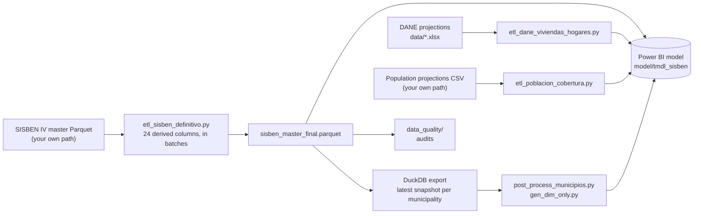
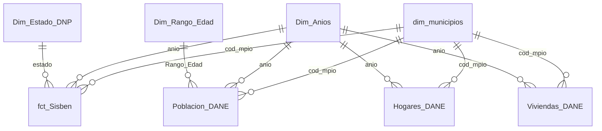

# SISBEN IV — ETL Pipeline & Power BI Semantic Model

End-to-end pipeline that ingests, cleans, validates and models SISBEN IV microdata for the 125 municipalities of Antioquia, Colombia, and serves the results through a Power BI tabular model defined as code (TMDL). At full scale it processed **~25M records across six annual snapshots (2021–2026)**, about 4–5M people per snapshot.

> **Privacy.** This repository never contains microdata. SISBEN IV records are personal data protected by Colombian Law 1581 of 2012. Whoever runs the pipeline sets every input and output path (command-line flags, environment variables or a local `.env`), and `.gitignore` blocks Parquet files and per-municipality CSVs. The sample in `data/sample/` is **synthetic**: every row was generated at random from the schema, and no value comes from a real record.

## Context

I built this pipeline in 2026, during my internship as a **Data & Economics Intern** at the Gobernación de Antioquia. There I built the first Power BI dashboard of Antioquia's Planning Department, and this pipeline is its data layer.

This repository is my personal, sanitized version of that work. It is not an official product of the Gobernación de Antioquia and is not endorsed by it. It contains none of its data, internal documents or branding.

## Highlights

- **Batch ETL in Python.** `src/etl/etl_sisben_definitivo.py` streams the master Parquet in 150,000-row batches with PyArrow and computes 24 derived columns with pandas and NumPy: classification order, housing materials, utilities, overcrowding, MPI housing deprivations, five-year age bands and health-insurance regime. Memory use is bounded by the batch size, not by the size of the table.
- **Faster model loads.** Moving those 24 columns out of DAX calculated columns and into this ETL cut the time to load the Power BI model from over 60 minutes to about 18.
- **SQL over Parquet with DuckDB.** The latest snapshot is exported per municipality, together with a downloads dimension for the dashboard.
- **DANE projections.** Household, dwelling and population projections are reshaped from wide to long and aligned to DIVIPOLA codes to compute coverage rates.
- **Semantic model as code.** `model/tmdl_sisben/` holds the full tabular model in TMDL: 19 tables, 10 relationships and 200+ DAX measures. Two PowerShell scripts deploy and audit parts of it through the Tabular Object Model.
- **Data-quality audits.** Column-by-column checks between the Parquet and the model, schema and cross-tab checks, and DAX heuristics.

## How it fits together



### Star schema



The diagram shows the 10 relationships in `model/tmdl_sisben/relationships.tmdl`. The other 11 tables are DNP catalogs and disconnected parameter tables that drive SWITCH-based measures and selectors.

| Type | Tables |
|---|---|
| Fact table | `fct_Sisben` (one row per person and snapshot) |
| Dimensions | `dim_municipios`, `Dim_Anios`, `Dim_Rango_Edad`, `Dim_Estado_DNP`, `Dim_Marca_DNP`, `Nivel_Sisben`, `Dim_Privacion`, `Dim_IPM_Dimension` |
| Housing dimensions | `Dim_Categoria_Vivienda`, `Dim_Bloque_Sanitario`, `Dim_Tipo_Evento`, `Dim_Evento`, `Tabla_Indicadores_Vivienda` |
| DANE tables | `Poblacion_DANE`, `Hogares_DANE`, `Viviendas_DANE` |
| Auxiliary | `Selector_Vivienda`, `Dim_Indicador_Hogar` |

## Tech stack

| Layer | Tools |
|---|---|
| Ingestion and transformation | Python · pandas · PyArrow · NumPy · DuckDB |
| Storage | Parquet (Snappy) |
| Data quality | Custom audit scripts |
| Semantic model | Power BI · TMDL · DAX · Tabular Object Model (PowerShell) |
| Configuration | Command-line flags · environment variables · `.env` |

## Repository structure

```
sisben-iv-etl-analytics-pipeline/
├── src/
│   ├── sisben_config.py                   # Shared configuration: flags > env vars > .env > defaults
│   ├── etl/
│   │   ├── etl_sisben_definitivo.py       # Main pipeline: derived columns in batches + per-municipality export
│   │   ├── etl_dane_viviendas_hogares.py  # DANE household and dwelling projections
│   │   ├── etl_poblacion_cobertura.py     # Population projections for coverage rates
│   │   └── upload_recursos.py             # Optional: copies the dictionary and reports to the publishing folder
│   ├── data_quality/
│   │   ├── check_schema.py                # Schema and year × status cross-tabs
│   │   ├── strict_audit.py                # Parquet vs. model columns, one by one
│   │   ├── dax_audit.py                   # DAX measure heuristics over TMDL
│   │   └── reinforce_parquet.py           # Schema fixes on an intermediate Parquet
│   └── utils/
│       ├── post_process_municipios.py     # Adds names to the per-municipality CSVs and rebuilds the dimension
│       ├── gen_dim_only.py                # Rebuilds the downloads dimension
│       └── tmdl_reorganize.py             # One-off TMDL refactor (display folders, renames)
├── model/
│   ├── tmdl_sisben/                       # Power BI tabular model in TMDL (19 tables)
│   ├── deploy_dq_model.ps1                # Adds the DNP quality dimensions and measures
│   └── master_audit_fixed.ps1             # Adds the DANE population table and refactors measures
├── scripts/
│   └── generate_synthetic_sample.py       # Builds the synthetic sample (no real data)
├── data/
│   ├── SOURCES.md                         # Sources, licenses and checksums
│   ├── divipola_antioquia.csv             # DANE DIVIPOLA codes for Antioquia (CC BY-SA 4.0)
│   ├── anexo-proyecciones-hogares-dptal-mpal-2018-2042.xlsx    # DANE
│   ├── anexo-proyecciones-viviendas-dptal-mpal-2018-2042.xlsx  # DANE
│   └── sample/                            # Synthetic samples
├── .env.example
├── requirements.txt
└── README.md
```

## Getting started

### Requirements

Python 3.10 or later. Tested on Python 3.14 with pandas 2.3 and 3.0, and DuckDB 2.0.

```bash
python -m venv .venv
source .venv/bin/activate        # Windows: .venv\Scripts\activate
pip install -r requirements.txt
```

### Configuration

Each script takes its paths from command-line flags, then environment variables, then a local `.env` file (copy `.env.example`), and then defaults that point to the public files in `data/` and to the `out/` folder. Run any script with `--help` to see its flags.

| Variable | Used by | Purpose |
|---|---|---|
| `SISBEN_PARQUET_IN` | Main ETL | Master Parquet with the microdata (required) |
| `SISBEN_OUTPUT_DIR` | All scripts | Local output folder (default: `out/`) |
| `SISBEN_POBLACION_CSV` | Population ETL | Population projections CSV (required by that script) |
| `SISBEN_PUBLISH_DIR`, `SISBEN_PUBLISH_BASE_URL` | Export and dimension scripts | Optional publishing folder and its base URL |

The per-municipality CSVs contain person-level records. Publish them only to an access-controlled location defined by the data controller.

### Run the whole pipeline on the synthetic sample

From the repository root:

```bash
# 1. Build the master Parquet from the synthetic sample
python scripts/generate_synthetic_sample.py --from-csv data/sample/sisben_synthetic_sample.csv --parquet-out out/sisben_master.parquet

# 2. Reference tables
python src/etl/etl_dane_viviendas_hogares.py
python src/etl/etl_poblacion_cobertura.py --csv-in data/sample/poblacion_synthetic_sample.csv

# 3. Main ETL, per-municipality export and downloads dimension
python src/etl/etl_sisben_definitivo.py --parquet-in out/sisben_master.parquet
python src/utils/post_process_municipios.py
python src/utils/gen_dim_only.py

# 4. Audits
python src/data_quality/strict_audit.py
python src/data_quality/check_schema.py
python src/data_quality/dax_audit.py --out out/dax_dict_dump.txt
```

Expected result: `out/sisben_master_final.parquet` with 302 rows and 135 columns (111 base + 24 derived), one CSV per municipality for the 2026 snapshot, and a strict audit with no missing or extra columns against the model.

### Run it on your own data

Set `SISBEN_PARQUET_IN`, and `SISBEN_POBLACION_CSV` for coverage rates, in your `.env`. Then run the same steps without the sample files.

### Power BI model

`model/tmdl_sisben/` is plain TMDL. Deploy it with Tabular Editor, or use it as the `definition` folder of a Power BI project (`.pbip`). Before refreshing, set three Power Query parameters:

- `SisbenDataDir`: folder with the ETL outputs (`sisben_master_final.parquet`, `poblacion_proyectada.parquet`, `hogares_dane.parquet`, `viviendas_dane.parquet`).
- `DivipolaWorkbookPath`: Excel workbook with the `tblMpiosAntio` table read by `dim_municipios`.
- `SisbenCsvFolder`: folder with the raw CSV files, used only by the legacy helper queries.

The PowerShell scripts take the local Analysis Services port, the database and the fact-table name as parameters.

## Data sources

- DANE, DIVIPOLA municipality codes, via datos.gov.co (CC BY-SA 4.0).
- DANE, household and dwelling projections by municipality, 2018–2042.

Links, terms and checksums are in [`data/SOURCES.md`](data/SOURCES.md). The repository does not include SISBEN IV microdata, institutional documents or dashboard screenshots from the internship.

## Author

**Valentina Vanegas Aristizábal** · Data & Economics Intern (2026) · [valentina-vanegas.pages.dev](https://valentina-vanegas.pages.dev/work/sisben-etl/)
